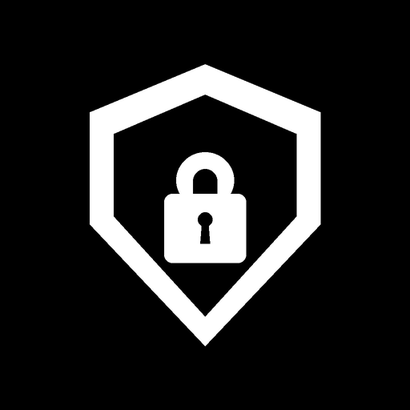
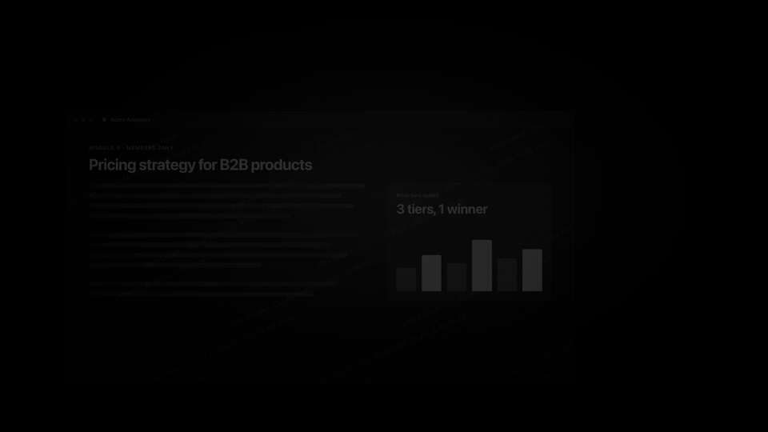

<p align="center">
  
</p>

# DRM-Wrap

Turn an existing website into a locked-down desktop app for Windows and macOS. Point DRM-Wrap at a URL (Laravel, React, Next.js, Vue, WordPress, plain HTML, whatever you run) and it gives you an Electron app that blocks screenshots, hides itself from screen shares, stamps a watermark over your content, and checks an offline license before it opens.

[](https://github.com/vecvel)
[](https://github.com/vecvel/drm-wrap/releases/latest)
[](LICENSE)
[](https://vecvel.github.io/drm-wrap/)
[](https://www.electronjs.org/)
[](https://www.typescriptlang.org/)
[](https://nodejs.org/)
[](https://github.com/vecvel/drm-wrap)

---

<p align="center">
  <a href="assets/promo.mp4"></a>
</p>

<p align="center"><a href="assets/promo.mp4">Watch the video with sound</a></p>

---

## Download

DRMWrap Studio is the desktop app: it does everything the CLI does, without a terminal. These links always download the latest release.

| Platform | Download | Notes |
|---|---|---|
| macOS (Apple silicon and Intel) | [DRMWrap-mac-universal.dmg](https://github.com/vecvel/drm-wrap/releases/latest/download/DRMWrap-mac-universal.dmg) | macOS 12 or later |
| macOS (Apple silicon and Intel) | [DRMWrap-mac-universal.zip](https://github.com/vecvel/drm-wrap/releases/latest/download/DRMWrap-mac-universal.zip) | Same app as a zip |
| Windows x64 | [DRMWrap-Setup-win-x64.exe](https://github.com/vecvel/drm-wrap/releases/latest/download/DRMWrap-Setup-win-x64.exe) | Installer |
| Windows x64 | [DRMWrap-Portable-win-x64.exe](https://github.com/vecvel/drm-wrap/releases/latest/download/DRMWrap-Portable-win-x64.exe) | Portable, no install |
| Windows x64 | [DRMWrap-win-x64.zip](https://github.com/vecvel/drm-wrap/releases/latest/download/DRMWrap-win-x64.zip) | Zip |
| CLI (Node.js 20+) | [`@vecvel/drm-wrap`](https://github.com/vecvel/drm-wrap/pkgs/npm/drm-wrap) | `npx @vecvel/drm-wrap init`, or grab the [tarball](https://github.com/vecvel/drm-wrap/releases/latest/download/drm-wrap-cli.tgz) |

Every file, including the demo app builds, is on the [releases page](https://github.com/vecvel/drm-wrap/releases/latest).

---

## Why this exists

If you sell courses, training material, internal dashboards or any other content that lives on the web, you've probably watched it end up in a screen recording somewhere. A browser can't do much about that. A desktop app can.

DRM-Wrap is a CLI and a desktop GUI that wrap your site in Electron and produce real installers (`.exe` for Windows, `.dmg` for macOS). You don't write desktop code and you don't touch your backend. The app loads your site as it is and adds the protections around it.

---

## What it does

### Screenshot and recording protection

The app turns on the operating system's own content protection (`setContentProtection(true)`). On Windows that's `SetWindowDisplayAffinity` with `WDA_MONITOR`, so screenshots and recordings come out as a black rectangle. On macOS it sets `NSWindowSharingNone`, which hides the window from screenshot tools and window capture APIs.

It also swallows the usual shortcuts: Print Screen, `Cmd+Shift+3/4/5`, `Win+Shift+S`, `Alt+PrtScn`, and the developer tool shortcuts.

### Invisible mode for screen sharing

When someone shares their screen in Zoom, Google Meet, Microsoft Teams, Discord, Slack or Webex, the protected window doesn't show up, whether they share the whole desktop or a single window. This works through window level placement and the OS's display exclusion APIs.

### Watermarks

A canvas layer sits on top of your page. It can't be clicked through or removed from the page, and it carries the customer's name, license ID, a timestamp and optionally a host hash. If a phone photo of the screen leaks, you know whose screen it was. Opacity, font size, angle, spacing and color are all set in the config.

### Recorder detection

Every few seconds the app checks running processes against a list of known capture tools: OBS (`obs`, `obs64`), Camtasia, ShareX, QuickTime Player, Windows Game Bar (`gamebar`, `bcastdvr`), Bandicam, Loom, ScreenFlow and others. You choose what happens when one turns up:

- `blur` puts a 40px blur over the whole window.
- `block` shows a full-screen notice asking the user to quit the recorder.
- `terminate` closes the app.

### Locked-down renderer

Context isolation is on, Node integration is off in the renderer, DevTools are disabled in production builds, and the right-click "Inspect" menu is gone.

### Offline licensing

Licenses are signed with Ed25519. The public key ships inside the app and the private key stays with you, so verification works fully offline and nobody can mint their own license. A license can be locked to a domain and its subdomains (for example `*.myplatform.com`), and it can be lifetime, a fixed number of days, or a short trial.

---

## Repository layout

```
drm-wrap/
├── .github/
│   └── workflows/
│       ├── build.yml                 # typecheck and packaging CI
│       ├── generate-license.yml      # issue licenses from GitHub Actions
│       ├── pages.yml                 # deploys the web license generator
│       └── release.yml               # builds installers and publishes on a v* tag
├── packages/
│   ├── lib/                          # published as @vecvel/drm-wrap: CLI and core engine
│   │   ├── src/cli/                  # CLI commands: init, config, dev, build, license
│   │   └── src/core/                 # scaffolding, licensing, detection
│   ├── desktop-app/                  # Electron app template
│   ├── studio/                       # DRMWrap Studio, the desktop GUI
│   └── license-admin/                # vendor only: key generation and license issuing
├── tools/
│   └── license-generator.html        # browser-based license generator
├── index.html                        # GitHub Pages entry, redirects to the generator
├── LICENSE                           # proprietary license
└── CODE_OF_CONDUCT.md                # code of conduct
```

| Package | What it is | Where it goes |
|---|---|---|
| [`packages/lib`](./packages/lib) | The CLI, the detection and licensing code, and the project generator. | Published as `@vecvel/drm-wrap` on GitHub Packages |
| [`packages/desktop-app`](./packages/desktop-app) | The Electron shell every generated app starts from. | Copied into generated projects |
| [`packages/studio`](./packages/studio) | DRMWrap Studio, a desktop app that does everything the CLI does, without a terminal. | Installers (`.dmg`, `.exe`) |
| [`packages/license-admin`](./packages/license-admin) | Scripts to create your signing keypair and issue licenses. | Internal, never published |
| [`tools/license-generator.html`](./tools/license-generator.html) | A license generator that runs in the browser. | GitHub Pages, or open the file locally |

---

## Built with

- [Electron 31+](https://www.electronjs.org/) for the desktop runtime
- [TypeScript 5.5](https://www.typescriptlang.org/)
- [Commander](https://github.com/tj/commander.js) and [@clack/prompts](https://github.com/natemoo-re/clack) for the CLI
- [electron-builder](https://www.electron.build/) for signing and packaging (DMG, NSIS)
- [Ed25519](https://ed25519.cr.yp.to/) signatures through `node:crypto` and WebCrypto
- [ps-list](https://github.com/sindresorhus/ps-list) to read the process table
- [Zod](https://zod.dev/) to validate the config

---

## Getting started

You need Node.js 20 or newer and npm 9 or newer.

### Working on this repo

```bash
git clone https://github.com/vecvel/drm-wrap.git
cd drm-wrap

npm install
npm run build        # builds the library and copies the app template

npm run dev          # runs the demo desktop app
npm run dev:studio   # runs DRMWrap Studio
```

---

### Wrapping a site with the CLI

Five commands take you from a URL to an installer:

```bash
# create a new project
npx @vecvel/drm-wrap init

# pick protections: screenshot blocking, watermark, recorder detection
npx @vecvel/drm-wrap config

# try it out
npx @vecvel/drm-wrap dev

# activate your license
npx @vecvel/drm-wrap license activate <YOUR_TOKEN_STRING>

# build .exe and .dmg installers
npx @vecvel/drm-wrap build
```

---

## Licensing

There's no license server. The app carries your public key, you sign licenses with your private key, and the app checks the signature offline.

### Token format

```
${base64url(JSON_payload)}.${base64url(Ed25519_signature)}
```

The signature is over the base64url string itself, not the parsed JSON, so whitespace or key order can't change what was signed.

There are three ways to issue a license.

---

### In the browser

Use the [hosted generator on GitHub Pages](https://vecvel.github.io/drm-wrap/), or open [`tools/license-generator.html`](./tools/license-generator.html) locally. It signs with WebCrypto, keeps your private key in the browser's `localStorage` and never sends it anywhere. Fill in the customer, email, tier (`single` or `extended`), optional domain and duration, then copy the token or download a `.lic` file. There's also a token inspector: paste any token to see its contents and check its signature.

---

### With GitHub Actions

Go to **Actions > Generate Customer License** and click **Run workflow**. Enter the customer name and email, the tier, an optional domain, and the validity type (`subscription`, `lifetime` or `trial`). The private key comes from the `LICENSE_PRIVATE_KEY` repository secret, or you can paste it in. The signed token shows up in the job summary and the `.lic` file is kept as an artifact for 30 days.

---

### From the terminal

```bash
# one-year subscription
npm run license:issue -- --customer "Apex Studios" --email "dev@apex.com" --tier single --days 365

# lifetime license locked to a domain
npm run license:issue -- --customer "Enterprise Corp" --email "admin@enterprise.com" --tier extended --domain enterprise.com --lifetime

# 14-day trial
npm run license:issue -- --customer "Beta Customer" --email "test@beta.com" --trial 14

# write a .lic file
npm run license:issue -- --customer "Omni Corp" --email "hi@omni.com" --out ./OmniCorp.lic
```

---

## Configuration

Everything lives in `drm-wrap.config.json`:

```json
{
  "appName": "Secure Portal",
  "appId": "com.mycompany.portal",
  "baseUrl": "https://portal.mycompany.com",
  "window": {
    "width": 1280,
    "height": 800,
    "minWidth": 800,
    "minHeight": 600,
    "resizable": true,
    "fullscreenable": true
  },
  "protections": {
    "contentProtection": true,
    "invisibleMode": true,
    "blockDevTools": true,
    "disableContextMenu": true,
    "processDetection": {
      "enabled": true,
      "intervalMs": 3000,
      "action": "blur",
      "customBlacklist": []
    },
    "watermark": {
      "enabled": true,
      "text": "Confidential • {{customer}} • {{date}}",
      "opacity": 0.15,
      "fontSize": 18,
      "density": "medium"
    }
  }
}
```

---

## What can it wrap?

Anything that's reachable over HTTP(S) or sits in a folder of web files. That includes Laravel, CodeIgniter, Symfony, WordPress, React, Next.js, Vue, Nuxt, SvelteKit, Angular, Django, Flask, FastAPI, Rails, Go (Gin, Fiber), and plain HTML, WebGL or canvas games.

---

## What it can't stop

Let's be honest about the limits. DRM-Wrap makes casual copying hard: the Snipping Tool, Print Screen, Game Bar, OBS, ShareX, Camtasia, an accidental share in a Zoom or Teams call, and someone poking around in DevTools.

It can't stop an HDMI capture card, a phone pointed at the monitor, or an operating system that has been compromised at the kernel level. Nothing running on the user's machine can. That's what the watermark is for: when something does leak, you can trace it.

---

## License

DRM-Wrap is proprietary software, &copy; 2026 vecvel. All rights reserved. See [LICENSE](LICENSE) for the terms and [CODE_OF_CONDUCT.md](CODE_OF_CONDUCT.md) for the code of conduct.

## Star history

<a href="https://star-history.com/#vecvel/drm-wrap&Date">
  <picture>
    <source media="(prefers-color-scheme: dark)" srcset="https://api.star-history.com/svg?repos=vecvel/drm-wrap&type=Date&theme=dark" />
    <source media="(prefers-color-scheme: light)" srcset="https://api.star-history.com/svg?repos=vecvel/drm-wrap&type=Date" />
    
  </picture>
</a>

---

<p align="center">
  Made by <a href="https://github.com/vecvel">@vecvel</a>
</p>
